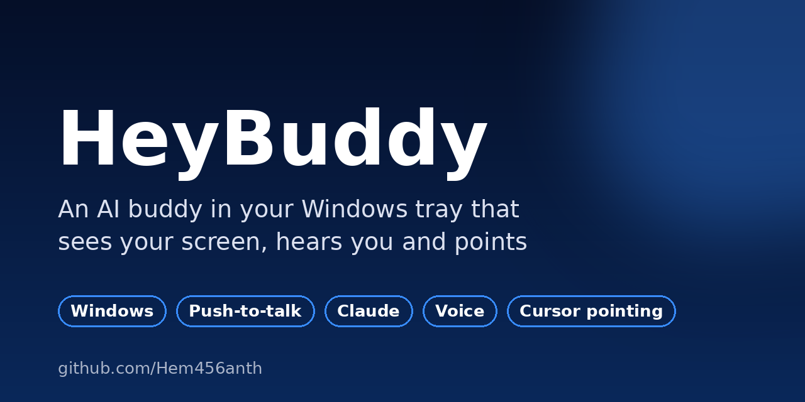

<div align="center">



# HeyBuddy 👋
### An AI buddy in your Windows system tray that sees your screen, hears your voice and points at things


[**⬇️ Download preview (v0.2.0)**](https://github.com/Hem456anth/HeyBuddy/releases/tag/v0.2.0-preview)

</div>

---

## About this project

HeyBuddy is a **Windows port of [farzaa/clicky](https://github.com/farzaa/clicky)**, a macOS AI companion. I loved the idea and wanted it on my Windows laptop, so I rebuilt it in Python with a lot of AI-assisted ("vibe") coding.

Hold a hotkey, ask a question out loud, and HeyBuddy takes a screenshot, asks Claude, speaks the answer back, and **flies a glowing blue cursor to the thing on screen** it's talking about. That makes it handy for learning new software.

It's a **personal, learning-first project**: it works for me, but it's a preview, not a polished product.

> **Credits:** all credit for the original idea and design goes to [@farzaa](https://github.com/farzaa) and Clicky. HeyBuddy reuses Clicky's Cloudflare Worker proxy (`/chat`, `/tts`, `/transcribe-token`) unchanged.

## Quick look

| Step | What happens |
|---|---|
| 1. Hold **Ctrl + Alt** | HeyBuddy starts listening |
| 2. Ask out loud | "Where's the export button in this app?" |
| 3. Release | A screenshot plus your question go to Claude |
| 4. Listen and watch | It answers by voice, and the blue cursor flies to the spot |

## What you need

- Windows 10 or 11 and a microphone
- Your own API keys: **Anthropic** (Claude), **AssemblyAI** (speech-to-text), **ElevenLabs** (voice)
- A free **Cloudflare** account to host the Worker that keeps your keys off the desktop app

> ⚠️ The download alone won't talk until you deploy the Worker with your own keys (step 1 below). These APIs are paid or free-tier.

## Features

The full pipeline is wired up:

- pystray tray icon → floating PyQt6 panel
- Push-to-talk via a Win32 low-level keyboard hook (preset chords)
- `sounddevice` PCM16 16 kHz mono recorder, streamed live into the STT WS
- AssemblyAI realtime v3 websocket transcription (token from `/transcribe-token`)
- Claude `/chat` SSE streaming with screenshot attachment + POINT-protocol
  system prompt
- `[POINT:x,y:label:screenN]` tag parsing + DPI-correct, bezier-arc cursor
  flight across any monitor
- ElevenLabs `/tts` synthesis + sounddevice playback
- Transient cursor mode (panel auto-hides during turns)
- Settings: model, hotkey preset, transient mode, autostart
- Diagnostics: Worker reachability ping + microphone level test
- Windows autostart via registry
- PyInstaller one-file build (`build.bat`)


---

## Setup checklist

### 1. Deploy the Cloudflare Worker

HeyBuddy reuses the upstream Worker. From the upstream repo:

```bash
git clone https://github.com/farzaa/clicky
cd clicky/worker
npm install

npx wrangler secret put ANTHROPIC_API_KEY
npx wrangler secret put ASSEMBLYAI_API_KEY
npx wrangler secret put ELEVENLABS_API_KEY
npx wrangler secret put ELEVENLABS_VOICE_ID   # or set as a var; ID of the voice you want

npx wrangler deploy
```

Note the deployed URL (e.g. `https://heybuddy.your-account.workers.dev`).

### 2. Install HeyBuddy (dev / from source)

```powershell
git clone https://github.com/Hem456anth/HeyBuddy.git
cd HeyBuddy
python -m venv .venv
.venv\Scripts\Activate.ps1
pip install -r requirements-desktop.txt
```

### 3. Point HeyBuddy at the Worker

Edit `config/settings.json`:

```json
{
  "worker_url": "https://heybuddy.your-account.workers.dev",
  ...
}
```

(Bare hostnames like `name.workers.dev` are also accepted; the client adds
`https://` automatically.)

### 4. Smoke-test the input path (no network)

```powershell
python -m src.tools.smoke_test
```

Hold Ctrl+Alt, speak, release. A `.wav` lands in `./recordings/`. If this
works the audio + hotkey plumbing is healthy.

### 5. Launch the app

```powershell
python -m src.main
```

A blue dot appears in your system tray. Click it → floating panel opens.
Hold Ctrl+Alt anywhere in Windows to talk to Claude.

Open **Settings** in the panel to:
- Change the model (Sonnet 4.6 default, Opus 4.7/4.8 available)
- Switch the push-to-talk chord (Ctrl+Alt, Ctrl+Shift, Alt+Shift, Right Alt, Alt+Space)
- Toggle transient cursor mode (panel hides during turns; just the cursor speaks)
- Enable Windows autostart
- **Ping** the Worker and **Test microphone** — run these first if anything misbehaves

### 6. (Optional) Build a standalone .exe

```powershell
pip install pyinstaller
build.bat
```

Produces `dist/HeyBuddy.exe` — a single file you can copy to other Windows
machines that don't have Python installed.

---

## How it works

The `CompanionManager` state machine runs:

```
IDLE → LISTENING → PROCESSING → RESPONDING → IDLE
```

On hotkey press it opens an AssemblyAI realtime websocket and starts the
mic; PCM blocks stream into the WS as they're captured. On release it
finalizes the transcript, grabs a screenshot of the cursor's monitor, asks
Claude over `/chat` SSE for a reply, then plays the response via TTS while
flying the blue cursor to any `[POINT:x,y:label:screenN]` markers Claude
embedded.

See [`CLAUDE.md`](CLAUDE.md) for the architecture in detail (threading
model, Worker contract, file layout, conventions, POINT protocol).

---

## Troubleshooting

| Symptom | Likely fix |
| --- | --- |
| "Worker unreachable" on Ping | URL typo, Worker not deployed, or running behind a VPN that blocks `*.workers.dev` |
| Worker reachable but Claude requests 401/403 | Worker is missing `ANTHROPIC_API_KEY` secret |
| Worker reachable but no token from `/transcribe-token` | Worker is missing `ASSEMBLYAI_API_KEY` secret |
| TTS silent but text appears | Worker is missing `ELEVENLABS_API_KEY` or `ELEVENLABS_VOICE_ID` |
| Hotkey doesn't fire | Another app's global hook may be eating it; pick a different preset in Settings |
| Mic test reports "silent" | Windows Sound settings → check input device + volume; ensure no other app has exclusive access |
| Cursor flies to wrong spot on HiDPI display | Open Settings → Save once; this re-applies per-monitor DPI awareness |
| `python -m src.main` shows a black console window | Use `pythonw -m src.main` (or just run the built `.exe`) |

Logs land in `logs/heybuddy.log` (rotated, 1 MB × 3 backups).

---

## Project layout

See [`CLAUDE.md`](CLAUDE.md) for the canonical file map and conventions.

---


## Honest status

- ✅ Push-to-talk, transcription, Claude replies, voice output and cursor pointing all work in my testing
- 🧪 The preview `.exe` is built by GitHub Actions from the `windows-port-v2` branch
- ⚠️ Tested on my own machines only; expect bugs on other setups
- ⚠️ You need your own paid or free-tier API keys and a deployed Worker

## Docs

| File | What's inside |
|---|---|
| [`CLAUDE.md`](CLAUDE.md) | Architecture, threading model, Worker contract, file map, POINT protocol |
| [`UPGRADES.md`](UPGRADES.md) | Upgrade checklist (GUI, cursor overlay, settings) |
| [`CONTRIBUTING.md`](CONTRIBUTING.md) | How to report bugs or suggest ideas |

## What I learned building it

- Porting a macOS app's ideas to Windows APIs (low-level keyboard hooks, DPI awareness, click-through overlays)
- Streaming audio over WebSockets for realtime transcription
- Streaming Claude replies (SSE) with screenshots
- Packaging a Python app as a single `.exe` with PyInstaller and CI

## License

MIT, in the same spirit as upstream Clicky.

<div align="center">

Made by **[Kundrapu Hemanth](https://www.linkedin.com/in/kundrapu-hemanth)** · still learning, still building

</div>
