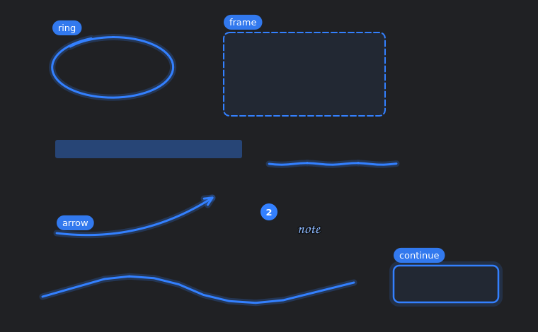

# HeyBuddy

A native Windows AI screen companion. It lives in your system tray, sees your
screen, listens while you hold **Ctrl+Alt**, answers out loud, **draws on
your screen** while it explains (rings, arrows, highlights), walks you through
tasks one click at a time, acts on your PC when you ask (open links, type,
files, PowerShell, with your approval), and hands bigger jobs to background
helpers.

It started as a Windows port of [farzaa/clicky](https://github.com/farzaa/clicky)
and in 0.3 gained the core experience of **HeyClicky for Windows**, rebuilt
clean-room from a reverse-engineering study
([docs/HEYCLICKY_TEARDOWN.md](docs/HEYCLICKY_TEARDOWN.md)).

**New in 0.4: Telugu mode.** Speak Telugu or Tenglish and hear Telugu back,
with speech by Gnani's Vachana models (Prisma STT, Timbre TTS), streamed so
the answer starts sooner. Switch it from the tray: *Language → Telugu*. See
[docs/TELUGU_MODE.md](docs/TELUGU_MODE.md).


> Credits: a Windows reimplementation of @farzaa's macOS Clicky (MIT). The
> Cloudflare Worker is wire-compatible with upstream.

## What it does

1. Hold **Ctrl+Alt** anywhere and ask a question ("how do I turn on dark mode here?").
   The blue triangle next to your mouse turns into a live waveform.
2. Let go. HeyBuddy captures every monitor and sends your question and the
   screenshots to Claude. The triangle becomes a spinner.
3. Claude answers out loud (ElevenLabs). If something on screen matters, the
   buddy swoops over to it, shows a little label, then flies back.

4. While it talks it draws: a loop around the button, an arrow to the menu,
   a highlight on the line that matters. Each drawing appears with the
   sentence that mentions it.
5. Ask "walk me through it" and it gives one step at a time, outlines the
   exact control to click, waits for your click, then continues.
6. Ask it to *do* something ("copy that address", "open the docs", "what's
   in my Downloads?") and it uses local tools. Commands and file writes ask
   you first.
7. Ask for something bigger ("research my competitors and make a PDF") and
   it starts a background job; the result shows up in the Jobs tab and is
   read out when it's done.



### Keys

| Gesture | What it does |
| --- | --- |
| hold **Ctrl+Alt** | talk (release under 0.5 s = ignored) |
| double-tap **Ctrl** | type a question in the quick-ask box |
| hold **Ctrl+Win** | dictate: your words are typed where the caret is |
| **Esc** | stop talking and clear drawings |

Press Ctrl+Alt again at any time to interrupt and ask something else.
Pressing any other key while holding the chord (Ctrl+Alt+Del, AltGr
characters) cancels instead of sending. The black **notch** at the top of
the screen shows when HeyBuddy is listening (cyan), thinking (pink) or
talking (orange); hover it to open the panel.

## Requirements

* Windows 10 version 2004 (build 19041) or later, or Windows 11, x64
* A microphone
* A free Cloudflare account plus API keys for
  [Anthropic](https://console.anthropic.com),
  [AssemblyAI](https://www.assemblyai.com) and
  [ElevenLabs](https://elevenlabs.io)
* For building from source: Python 3.11–3.13 x64 and Node.js 18+ (Worker only)

## 1. Deploy the Worker (holds your API keys)

```bash
cd worker
npm install
npx wrangler secret put ANTHROPIC_API_KEY
npx wrangler secret put ASSEMBLYAI_API_KEY
npx wrangler secret put ELEVENLABS_API_KEY
# voice: edit ELEVENLABS_VOICE_ID in worker/wrangler.toml
npx wrangler deploy
```

For Telugu mode, also add your Gnani key (voice and model are vars in
`wrangler.toml`; see [docs/TELUGU_MODE.md](docs/TELUGU_MODE.md)):

```bash
npx wrangler secret put GNANI_API_KEY
```

Optional but recommended (see [SECURITY.md](SECURITY.md)):

```bash
npx wrangler secret put APP_SHARED_SECRET   # paste the same value into HeyBuddy → Settings → Worker access key
```

Copy the deployed URL, e.g. `https://heybuddy-proxy.you.workers.dev`.

## 2a. Install the prebuilt app

From the repository's **Releases**, download **`HeyBuddy-Setup-0.4.0.exe`**
and run it. It installs for your user only (no admin), adds a Start menu
entry, and can start HeyBuddy when you sign in. Uninstall from *Settings →
Apps*; it asks whether to keep your settings, memory and jobs.

Prefer portable? Download `HeyBuddy-windows-x64.zip`, unzip, run `HeyBuddy.exe`.
Windows SmartScreen may warn because the build is unsigned: *More info → Run
anyway*. Check downloads against `SHA256SUMS.txt`.

## 2b. Or run from source

```powershell
git clone https://github.com/Hem456anth/HeyBuddy.git
cd HeyBuddy
py -3.12 -m venv .venv
.venv\Scripts\Activate.ps1
pip install -r requirements-desktop.txt
python -m src.main          # or pythonw -m src.main for no console
```

## 3. First launch

The panel opens and the blue buddy appears next to your mouse.
Click **⚙ Settings**, paste the Worker URL, then:

* **Ping** — checks the Worker and your AssemblyAI key
* **Test microphone** — checks your input level

Hold **Ctrl+Alt**, talk, release.

Settings, logs and (optional) recordings live in `%APPDATA%\HeyBuddy`
(tray menu → *Open Logs and Settings Folder*).

### Tray menu

| Item | Does |
| --- | --- |
| Open | show/hide the panel (chat history, text box) |
| Toggle Companion | mute the hotkey (e.g. during meetings) |
| Show Buddy Cursor | buddy always visible, or only during a turn |
| Language | English (AssemblyAI + ElevenLabs) or Telugu / తెలుగు (Gnani STT + TTS, Telugu replies); saved, applies from the next turn |
| Jobs | open the Jobs tab (background helpers, their files) |
| Clear Conversation | forget the last 10 exchanges |
| Settings | General: model, hotkey, mic, voice, autostart, Worker access key. Abilities and privacy: drawings, guided steps, dictation, quick-ask, tools and their approval rules, jobs, memory |
| Report a Bug | opens a GitHub issue |
| Quit | exit |

## Build the .exe

```powershell
build.bat
```

Creates a venv, installs `requirements-dev.txt`, runs the tests, builds
`dist\HeyBuddy.exe` with PyInstaller (one file, no console, ~60 MB including
Qt and ffmpeg), then launches it with `--selfcheck` and fails the build if the
self-check fails.

CI does the same on every push (`.github/workflows/windows-build.yml`) and
attaches the zip to a GitHub Release when you push a `v*` tag.

## Self-check (works without API keys)

```powershell
HeyBuddy.exe --selfcheck          # or: python -m src.main --selfcheck
```

Runs the real pipeline against a local mock Worker: monitor enumeration,
multi-screen capture, Claude SSE parsing, POINT → pixel mapping, MP3 decode,
overlay window styles, and two real screen grabs proving the buddy is drawn
on screen but hidden from capture. Results:
`%APPDATA%\HeyBuddy\selfcheck\selfcheck.json` (+ PNG evidence). Exit code 0 = pass.

## Tests

```powershell
pip install -r requirements-dev.txt
python -m pytest -q
```

126 tests cover Telugu mode (Gnani realtime STT framing and pacing, SSE/REST
TTS and its fallback, the REST STT fallback, the Telugu number/markup
normaliser, streamed `say()` chunking, the tray toggle, and full Telugu turns
against a local mock WebSocket/SSE Worker), the buddy-program parser (including real HeyClicky-style
programs and hostile input), legacy POINT tags, coordinate mapping, tool
safety rules, the tool loop and background jobs against the mock Worker,
gestures, multi-turn transcripts, the motion model, config robustness, and
(off-Windows) offscreen rendering of every buddy state, every drawing and
the notch. See [docs/TESTING.md](docs/TESTING.md).

## Troubleshooting

| Symptom | Fix |
| --- | --- |
| "Worker URL is not set" | Settings → paste your `*.workers.dev` URL |
| Ping: 401 | Worker has `APP_SHARED_SECRET`; paste it into *Worker access key* |
| Ping OK, Claude fails 400 "model" | pick a current model in Settings, or check `ALLOWED_MODELS` on the Worker |
| No voice, text appears | Worker missing `ELEVENLABS_API_KEY` / voice id; "Voice unavailable" banner shows the reason |
| Hotkey does nothing | another app grabs Ctrl+Alt: choose another chord in Settings; check *Toggle Companion* is on |
| Typing AltGr characters starts a turn | it now cancels automatically; or switch the chord to Right Alt / Ctrl+Shift |
| Buddy points at the wrong place | check `DPI awareness: per-monitor-v2` in `heybuddy.log`; send the log's `POINT flight:` lines with an issue |
| Buddy appears in screenshots | Windows older than 2004 can't exclude windows from capture; harmless |
| Two buddies | only one instance runs now; kill stray `pythonw.exe` from older versions |
| It asks before every command | Settings → Abilities → *Run PowerShell commands* → Always allow (or Never) |
| Drawings stay too long / vanish too fast | Settings → Abilities → *Keep drawings for* |
| Ctrl+Win opens the Start menu | update to 0.3.0; or pick Ctrl+Shift+Space for dictation |
| Quick-ask box doesn't take typing | click into it once; some full-screen apps block focus changes |
| Telugu mode: "Telugu mode is not configured" | `npx wrangler secret put GNANI_API_KEY` and redeploy |
| Telugu mode: English words show in Telugu script | expected: Gnani STT `te-IN` transliterates code-mixed English |

## Docs

* [docs/HEYCLICKY_TEARDOWN.md](docs/HEYCLICKY_TEARDOWN.md) — how HeyClicky for Windows works, what HeyBuddy reproduces, what it doesn't
* [docs/REVERSE_ENGINEERING.md](docs/REVERSE_ENGINEERING.md) — how Clicky works and how each part maps to Windows
* [docs/TELUGU_MODE.md](docs/TELUGU_MODE.md) — Telugu mode with Gnani: setup, verified endpoints, live latency numbers, limits, challenge checklist
* [docs/TESTING.md](docs/TESTING.md) — test plan and latest results
* [THIRD_PARTY_NOTICES.md](THIRD_PARTY_NOTICES.md) — dependency inventory and licenses
* [CLAUDE.md](CLAUDE.md) — architecture, threading, file map, conventions (for contributors and coding agents)
* [SECURITY.md](SECURITY.md) — data flow, storage, Worker hardening

## License

MIT — see [LICENSE](LICENSE).
